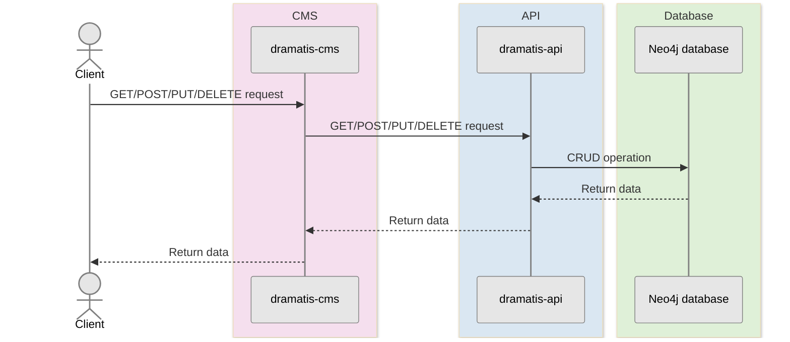
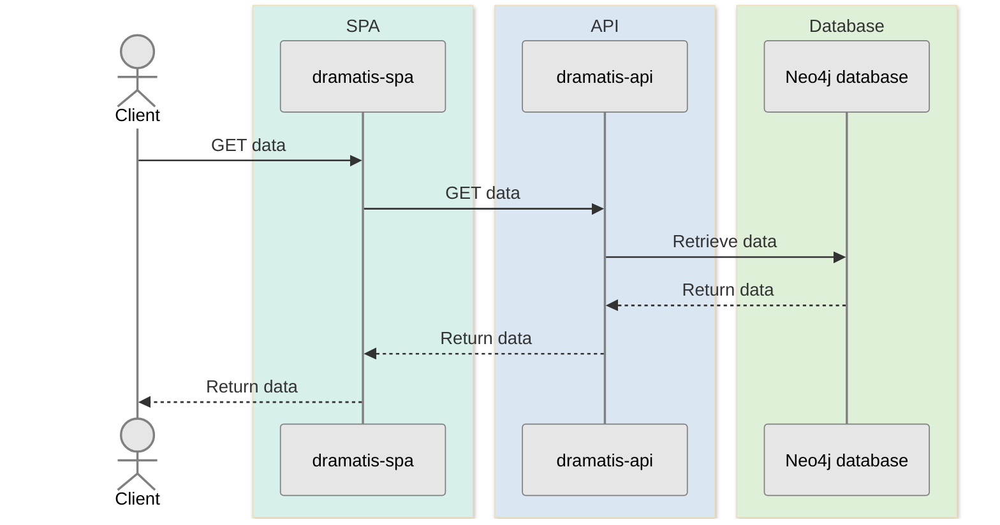
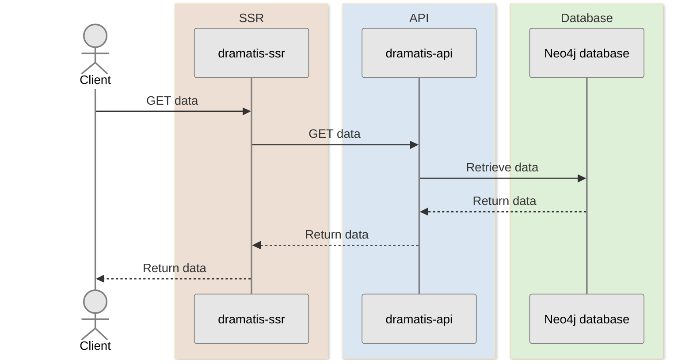

# dramatis-api 

Graph database-driven API for site of theatrical productions, materials, and associated data.

## Setup

- Clone this repo
- Set Node.js to version specified in `.nvmrc`, which can be achieved by running `$ nvm use` (if using [Volta](https://docs.volta.sh/guide/getting-started) then it will be set automatically)
- Install Node.js modules: `$ npm clean-install`
- Copy development environment variables from `.env-dev` into `.env` by running command `$ npm run transfer-env-dev`; N.B. values may need to be amended to match your specific local database configuration (see: [Database setup](https://github.com/andygout/dramatis-api#user-content-database-setup))

## Database setup

- Download the [Neo4j Desktop 2 app](https://neo4j.com/download) (the version of the Neo4j image in `docker/docker-compose.yml` will be a compatible version)
- Create a local Neo4j graph database, configuring as to:
  - Neo4j user name matches `.env` `DATABASE_USERNAME` value
    - For local instances this will be `neo4j`, which can be verified by viewing the `username` values returned by this Cypher query: `CALL dbms.listConnections()`
  - Neo4j local graph database password matches `.env` `DATABASE_PASSWORD` value
  - `.env` `DATABASE_URL` value is endpoint on which Neo4j local graph database is running
    - The connection URI is viewable on the Neo4j Desktop 2 app by navigating to the applicable database and then: `…` → `Overview`

> [!NOTE]
> Should you encounter `Neo4jError: There is not enough memory to perform the current task` when seeding the database then perform the following steps:
>
> - Open the Neo4j Desktop 2 app
> - For the applicable database, click `…` → `Open` → `neo4.conf` (opening with a text editor), then increase the memory allocation, e.g.
>   - `server.memory.heap.initial_size=512m` → `server.memory.heap.initial_size=5000m`
>   - `server.memory.heap.max_size=1G` → `server.memory.heap.max_size=2G`
> - Save the file (and re-start the database instance if running)

## To run local Neo4j graph database

- Open the Neo4j Desktop 2 app
- Press `►` for the applicable database

## To run locally

- Run local Neo4j graph database
- Run server using `$ npm start`
- Visit routes via `http://localhost:3000` (e.g. `http://localhost:3000/productions`)

## To seed database

- Ensure that a local instance of Neo4j graph database and app are running
- Run `$ npm run seed-db`

## To manage content via CMS (content management system) (locally)

- Run a local instance of [`dramatis-cms`](https://github.com/andygout/dramatis-cms) on `http://localhost:3001`, which will point at this API on port 3000

## To view content via user interface (locally)

- Run a local instance of [`dramatis-spa`](https://github.com/andygout/dramatis-spa) (single-page application) on `http://localhost:3002`, which will point at this API on port 3000

or

- Run a local instance of [`dramatis-ssr`](https://github.com/andygout/dramatis-ssr) (server-side rendered) on `http://localhost:3003`, which will point at this API on port 3000

## To run linting checks

- `$ npm run lint-check`

## To run unit tests

- `$ npm run unit-test`

## To run integration tests

- `$ npm run int-test`

## To run end-to-end tests

- Download and run the [Docker Desktop app](https://www.docker.com/products/docker-desktop)
- Stop any Neo4j databases running on the Neo4j Desktop 2 app if they share the same port number as that used by the Docker-served Neo4j instance
- Start the Docker-served resources by running `$ npm run e2e-test-resources` and wait until they are ready
- In a separate CLI tab run `$ npm run e2e-test`
- The Docker-served Neo4j database can be queried via the Neo4j Browser by visiting `http://localhost:7474`

## A note on data used for tests

For the purposes of providing focused and sufficient test coverage, the data used for tests is a mixture of:

- real data, e.g. entirely from a real-life production
- real data with contrived elements, e.g. a real-life play whose credits include made-up entities
- wholly contrived data, e.g. a made-up awards ceremony that nominates made-up entities

## Endpoints

Using venue model as an example.

### GET `/venues/new`

- Get data required to prepare **new** venue

### POST `/venues`

- **Create** venue
- Requires body, e.g. `{ "name": "National Theatre" }`

### GET `/venues/:uuid/edit`

- Get data required to **edit** specific venue

### PUT `/venues/:uuid`

- **Update** specific venue
- Requires body, e.g. `{ "name": "Almeida Theatre" }`

### DELETE `/venues/:uuid`

- **Delete** specific venue

### GET `/venues/:uuid`

- **Show** specific venue

### GET `/venues`

- **List** venues

## Architecture

[`dramatis-cms`](https://github.com/andygout/dramatis-cms) manages the content.

---

[`dramatis-spa`](https://github.com/andygout/dramatis-spa) visualises the content.

---

[`dramatis-ssr`](https://github.com/andygout/dramatis-ssr) visualises the content.

